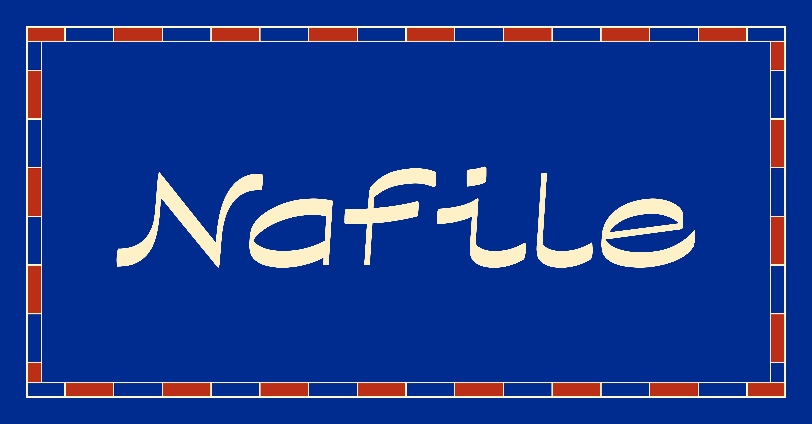

# Nafile

[](https://nafile.ertekin.xyz)

Nafile is a modern-arabesque display typeface, offering a vast and versatile family with 6 widths and weights from Thin to Black, all in a variable, open-source format. The project was born in Barcelona, inspired by the city where the initial sketches came to life. I was moved by the way Barcelona’s Gothic roots, Catalan modernism, Mediterranean charm, and touches of Arabesque all blended into the city’s modern rhythm. This unique mix of influences became the heart of the typeface.

All weights, widths, and styles of the Nafile typeface can be tested on [nafile.ertekin.xyz](https://nafile.ertekin.xyz)


## Building the Fonts

The source is `sources/Nafile.glyphs` (Glyphs 3). The fonts are built with [gftools builder](https://github.com/googlefonts/gftools), the same toolchain Google Fonts uses.

Set up a virtual environment once:

```
python3 -m venv venv
source venv/bin/activate
pip install -r requirements.txt
```

Then build:

```
gftools builder sources/config.yaml
```

Output goes to `fonts/`:

- `fonts/variable`: `Nafile[wdth,wght].ttf`
- `fonts/ttf`: static TTFs
- `fonts/otf`: static OTFs
- `fonts/webfonts`: WOFF2

To check the fonts against Google Fonts' requirements:

```
fontbakery check-googlefonts fonts/variable/*.ttf
```

## License

Nafile is licensed under the SIL Open Font License v1.1, see [OFL.txt](OFL.txt) for details.
